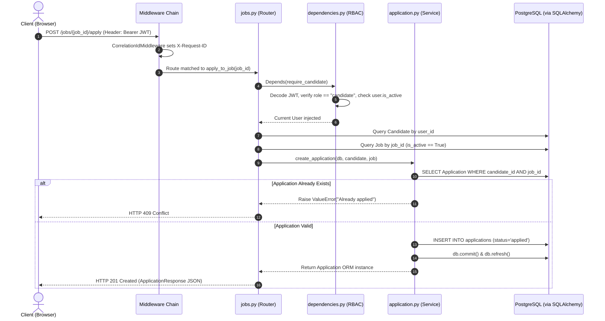

# 🏛️ Module 03 — Hirely Backend Architecture Deep Dive

> **CONFIDENTIAL & PRIVATE STUDY MATERIAL**  
> *Target Roles: AI Engineer, Applied AI Engineer, Backend AI Engineer*  
> [← Back to Study Notes Index](./README.md) • [Previous Module: Project Explanation in Hinglish ←](./02_project_explanation_hinglish.md) • [Next Module: AI, ML & RAG →](./04_ai_ml_and_rag.md)

---

## 📌 Table of Contents
- [1. Backend Overview & Architecture Paradigm](#1-backend-overview--architecture-paradigm)
- [2. Module Organization & Codebase Tree](#2-module-organization--codebase-tree)
- [3. FastAPI Application Initialization & Middleware Chain](#3-fastapi-application-initialization--middleware-chain)
- [4. API Request Lifecycle & Layered Boundaries](#4-api-request-lifecycle--layered-boundaries)
- [5. PostgreSQL Database Schema & Relational Integrity](#5-postgresql-database-schema--relational-integrity)
- [6. SQLAlchemy 2.0 ORM & Session Lifecycle Management](#6-sqlalchemy-20-orm--session-lifecycle-management)
- [7. Alembic Migration Strategy & Version History](#7-alembic-migration-strategy--version-history)
- [8. Authentication, Argon2, JWT & Role-Based Access Control](#8-authentication-argon2-jwt--role-based-access-control)
- [9. Resume Upload, Multi-Layer Validation & Storage Engine](#9-resume-upload-multi-layer-validation--storage-engine)
- [10. Error Handling Strategy & Exception Classification](#10-error-handling-strategy--exception-classification)
- [11. Architectural Decisions & Alternatives Analysis](#11-architectural-decisions--alternatives-analysis)

---

## 1. Backend Overview & Architecture Paradigm

The Hirely backend is built with **Python 3.12** and **FastAPI**, designed around a **layered, domain-driven architecture**. It deliberately separates:
1. **API Controllers (`app/api/`):** Route handling, HTTP status codes, and dependency injection.
2. **Business Services (`app/services/` & `app/ai/`):** Domain logic, orchestration, and model invocation.
3. **Data Access & Models (`app/models/` & `app/db/`):** SQLAlchemy ORM entities and database session lifecycles.
4. **Validation Contracts (`app/schemas/`):** Strict Pydantic v2 request/response schemas.
5. **Core Infrastructure (`app/core/` & `app/storage/`):** Configuration, rate limiting, security, observability, and storage providers.

```text
┌─────────────────────────────────────────────────────────────────────────────┐
│                              CLIENT REQUEST                                 │
└──────────────────────────────────────┬──────────────────────────────────────┘
                                       │ HTTP / JSON
                                       ▼
┌─────────────────────────────────────────────────────────────────────────────┐
│                           ASGI MIDDLEWARE STACK                             │
│  ├── CorrelationIdMiddleware: Assigns or validates X-Request-ID (contextvars)│
│  └── CORSMiddleware: Strict origin validation without wildcard credentials  │
└──────────────────────────────────────┬──────────────────────────────────────┘
                                       │
                                       ▼
┌─────────────────────────────────────────────────────────────────────────────┐
│                            FASTAPI ROUTERS                                  │
│  Controllers handle routing, HTTP status codes, and OpenAPI documentation   │
└──────────────────────────────────────┬──────────────────────────────────────┘
                                       │ Depends()
                                       ▼
┌─────────────────────────────────────────────────────────────────────────────┐
│                        DEPENDENCY INJECTION LAYER                           │
│  ├── Rate Limiter (check_auth_rate_limit / check_ai_rate_limit)             │
│  ├── Database Session (get_db yields SQLAlchemy Session per request)        │
│  └── Auth & RBAC (get_current_user, require_candidate, require_recruiter)    │
└──────────────────────────────────────┬──────────────────────────────────────┘
                                       │
                                       ▼
┌─────────────────────────────────────────────────────────────────────────────┐
│                         DOMAIN SERVICE LAYER                                │
│  Deterministic business workflows, scoring engines, and storage services    │
└──────────────────┬───────────────────────────────────────────┬──────────────┘
                   │                                           │
                   ▼                                           ▼
┌──────────────────────────────────────┐   ┌──────────────────────────────────┐
│         DATA ACCESS LAYER            │   │         AI DOMAIN LAYER          │
│ SQLAlchemy 2.0 ORM Models            │   │ Context Assemblers, Prompting,   │
│ Session commit / rollback boundaries │   │ Google Gemini Client, Embeddings,│
│ PostgreSQL 15 Relational Database    │   │ and Substring Citation Verifiers │
└──────────────────────────────────────┘   └──────────────────────────────────┘
```

---

## 2. Module Organization & Codebase Tree

```text
backend/
├── alembic/                         # Database migration environment
│   ├── versions/                    # 7 sequential schema migration scripts
│   └── env.py                       # Alembic execution environment importing Base & settings
├── app/
│   ├── ai/                          # AI domain submodules
│   │   ├── ats_analyzer/            # ATS scoring service, prompt templates, schemas
│   │   ├── candidate_intelligence/  # Candidate semantic filtering and scoring
│   │   ├── career_coach/            # Career coaching service and prompts
│   │   ├── cover_letter/            # Grounded cover letter generation
│   │   ├── embeddings/              # Gemini embedding service & cosine similarity
│   │   ├── eval/                    # Deterministic offline evaluation runner & datasets
│   │   ├── job_description_analyzer/# JD quality and structural clarity analyzer
│   │   ├── loaders/                 # Text & document loaders
│   │   ├── matching/                # Two-sided applicant matching orchestrator
│   │   ├── parsers/                 # Docling C++ document parser service
│   │   ├── prompts/                 # Core prompt engineering & system instructions
│   │   ├── rag/                     # Candidate Resume Evidence Assistant RAG pipeline
│   │   ├── representations/         # Structured candidate & job text representations
│   │   ├── resume_improvement/      # Bullet rewrite & missing skill diagnosis
│   │   └── services/                # Gemini client abstraction, token & retry logic
│   ├── api/                         # FastAPI route definitions
│   │   ├── applications.py          # /applications/me, /applications/recruiter, /status
│   │   ├── auth.py                  # /auth/register, /auth/login, /auth/me
│   │   ├── candidate.py             # /candidate/profile and candidate AI routes
│   │   ├── candidate_skills.py      # /candidate/skills CRUD
│   │   ├── dependencies.py          # FastAPI dependencies: get_db, auth, RBAC
│   │   ├── health.py                # /health and /health/db
│   │   ├── jobs.py                  # /jobs CRUD, /apply, /match
│   │   ├── job_skills.py            # /jobs/{job_id}/skills CRUD
│   │   ├── recruiter.py             # /recruiter/profile, /jobs, /description-analysis, RAG
│   │   └── resumes.py               # /resumes upload, parse, activate, delete
│   ├── core/                        # Cross-cutting platform concerns
│   │   ├── observability/           # Contextvars, structured logging, latency metrics
│   │   ├── config.py                # Pydantic BaseSettings loading from .env
│   │   ├── rate_limit.py            # In-memory sliding-window rate limiters
│   │   └── security.py              # Argon2 password hasher & JWT creation/verification
│   ├── db/                          # Database connection and session factory
│   │   ├── base.py                  # SQLAlchemy DeclarativeBase
│   │   └── session.py               # Engine configuration, connection pooling, get_db
│   ├── models/                      # 10 SQLAlchemy ORM Entities
│   │   ├── user.py, candidate.py, recruiter.py, company.py, job.py,
│   │   ├── application.py, skill.py, candidate_skill.py, job_skill.py, resume.py
│   │   └── __init__.py              # Central entity exports for Alembic
│   ├── schemas/                     # Pydantic validation contracts
│   │   ├── application.py, auth.py, candidate.py, job.py,
│   │   ├── recruiter.py, resume.py, skill.py
│   ├── services/                    # Core business logic services
│   │   ├── application.py, auth.py, candidate.py, candidate_skill.py,
│   │   ├── job.py, job_skill.py, recruiter.py, resume.py, resume_skill.py, skill.py
│   ├── storage/                     # File storage abstractions
│   │   ├── file_validation.py       # Multi-layer PDF security checks
│   │   └── storage_service.py       # Local filesystem vs Cloudflare R2 provider
│   └── main.py                      # FastAPI application factory & router registration
├── tests/                           # Complete test suite (50+ unit/integration test files)
├── alembic.ini                      # Alembic root config referencing backend/alembic
├── Dockerfile                       # Python 3.12-slim production container image
└── pytest.ini                       # Test configuration with pythonpath and custom markers
```

---

## 3. FastAPI Application Initialization & Middleware Chain

Hirely initializes the application in [`backend/app/main.py`](file:///D:/Hirely/backend/app/main.py):

```python
# 1. Initialize structured privacy-preserving observability
setup_observability(level=logging.INFO)

app = FastAPI(
    title=settings.app_name,
    description="Backend API for Hirely",
    version=settings.app_version,
    debug=settings.debug,
)

# 2. Correlation ID Middleware (Outer-most layer)
app.add_middleware(CorrelationIdMiddleware)

# 3. Dynamic CORS Middleware
cors_origins = [origin for origin in settings.cors_origins if origin]
has_wildcard = "*" in cors_origins
allow_credentials = False if has_wildcard else True

app.add_middleware(
    CORSMiddleware,
    allow_origins=cors_origins,
    allow_credentials=allow_credentials,
    allow_methods=["*"],
    allow_headers=["*"],
)
```

### Critical Middleware Details:
1. **`CorrelationIdMiddleware`:** Intercepts incoming requests. Reads the `X-Request-ID` header, sanitizes it (stripping `\r\n` to prevent header injection), and injects it into thread-safe Python `contextvars`. If missing or invalid, it mints a fresh UUID4.
2. **`CORSMiddleware` Security Guard:** Dynamic origins are loaded from `CORS_ORIGINS`. Crucially, the code enforces: **Never combine credentialed requests (`allow_credentials=True`) with a wildcard (`*`) origin**, preventing cross-origin session hijacking.

---

## 4. API Request Lifecycle & Layered Boundaries

To see how the boundaries work in practice, let's trace the execution flow when a candidate applies to a job:



---

## 5. PostgreSQL Database Schema & Relational Integrity

The database comprises **10 relational tables** defined in [`backend/app/models/`](file:///D:/Hirely/backend/app/models/):

```text
┌─────────────────┐       1:1       ┌─────────────────┐
│      users      ├─────────────────┤   candidates    │
│ id (UUID, PK)   │                 │ id (UUID, PK)   │
│ email (Unique)  │                 │ user_id (FK)    │
│ role (Enum)     │                 │ headline, bio   │
│ hashed_password │                 └────────┬────────┘
└────────┬────────┘                          │
         │ 1:1                               ├────────────────────┐
         ▼                                   │ 1:N                │ 1:N
┌─────────────────┐                          ▼                    ▼
│   recruiters    │                 ┌─────────────────┐  ┌─────────────────┐
│ id (UUID, PK)   │                 │     resumes     │  │candidate_skills │
│ user_id (FK)    │                 │ id (UUID, PK)   │  │candidate_id (FK)│
│ company_id (FK) ├──┐              │ candidate_id(FK)│  │skill_id (FK)    │
└─────────────────┘  │ N:1          │ file_path/key   │  └────────┬────────┘
                     ▼              │ is_active (bool)│           │
            ┌─────────────────┐     │ parsed_data JSON│           │ N:1
            │    companies    │     └─────────────────┘           ▼
            │ id (UUID, PK)   │                          ┌─────────────────┐
            │ name, website   │                          │     skills      │
            └────────┬────────┘                          │ id (UUID, PK)   │
                     │ 1:N                               │ name (Unique)   │
                     ▼                                   └────────▲────────┘
            ┌─────────────────┐                                   │
            │      jobs       │                                   │ N:1
            │ id (UUID, PK)   ├───────────────┐          ┌────────┴────────┐
            │ recruiter_id(FK)│               │ 1:N      │   job_skills    │
            │ title, is_active│               ▼          │ job_id (FK)     │
            └────────┬────────┘     ┌─────────────────┐  │ skill_id (FK)   │
                     │              │  applications   │  │ is_required     │
                     └─────────────►│ id (UUID, PK)   │  └─────────────────┘
                               1:N  │ candidate_id(FK)│
                                    │ job_id (FK)     │  <-- UniqueConstraint
                                    │ status (Enum)   │      (candidate_id, job_id)
                                    └─────────────────┘
```

### Critical Database Integrity Rules:
1. **Duplicate Application Prevention:** `UniqueConstraint("candidate_id", "job_id", name="uq_candidate_job")` guarantees an applicant can never submit multiple applications to the same opening.
2. **Foreign Key Cascades:** Deleting a candidate automatically cleans up their `candidate_skills` and `resumes` records.
3. **Application Status State Machine:** Enforced via `ApplicationStatus` Enum:
   $$\text{applied} \longrightarrow \text{shortlisted} \longrightarrow \text{interview} \longrightarrow \text{hired} \quad \text{or} \quad \text{rejected}$$
   Terminal states are `hired` and `rejected`.

---

## 6. SQLAlchemy 2.0 ORM & Session Lifecycle Management

Database connection pooling and session lifecycle are managed in [`backend/app/db/session.py`](file:///D:/Hirely/backend/app/db/session.py):

### A. Engine Configuration & Connection Pool Budgeting
```python
engine = create_engine(
    settings.database_url,
    pool_size=settings.db_pool_size,          # Default: 5
    max_overflow=settings.db_max_overflow,    # Default: 10
    pool_timeout=settings.db_pool_timeout,    # Default: 30s
    pool_recycle=settings.db_pool_recycle,    # Default: 1800s (30m)
    pool_pre_ping=settings.db_pool_pre_ping,  # Default: True (tests connection liveness)
)
```

**Worker Connection Formula:**
$$\text{Max PostgreSQL Connections} = (\text{DB\_POOL\_SIZE} + \text{DB\_MAX\_OVERFLOW}) \times \text{Uvicorn Workers}$$
$$\text{Max Connections} = (5 + 10) \times 4 = 60$$
This guarantees that 4 workers consume at most 60 slots out of PostgreSQL's default `max_connections = 100`, reserving 40 connections for schema migrations, superuser administration (`superuser_reserved_connections = 3`), and monitoring.

### B. Session Lifecycle Pattern (`get_db`)
```python
def get_db():
    db = SessionLocal()
    try:
        yield db
    finally:
        db.close()
```
FastAPI automatically yields the database session to the router dependency. When the HTTP request finishes (whether with success or an unhandled exception), the `finally` block executes, returning the connection back to the SQLAlchemy pool and preventing connection leaks.

---

## 7. Alembic Migration Strategy & Version History

Hirely maintains 7 sequential, version-controlled schema migrations under [`backend/alembic/versions/`](file:///D:/Hirely/backend/alembic/versions/):

| Revision ID | Description | Created Tables / Schema Changes |
| :--- | :--- | :--- |
| `686f5e817bad` | Create initial user profiles | `users`, `candidates`, `recruiters` |
| `86847c4ad53a` | Add companies & recruiter relation | `companies` table, `recruiter.company_id` foreign key |
| `2a3d08cd70c2` | Clean recruiter company name | Drops redundant `company_name` string column from recruiters |
| `8b276abe3679` | Add jobs table | `jobs` table with title, description, location, recruiter foreign key |
| `1fcd1e35fb2f` | Add applications table | `applications` table with state machine enum and unique constraint |
| `0001d605bd8c` | Add skills tables | `skills`, `candidate_skills`, and `job_skills` association tables |
| `ed9389445137` | Add resumes table | `resumes` table with storage paths, parsing status, and JSON data |

In Docker Compose, the `hirely-migration` container runs `alembic upgrade head` automatically before the backend starts, ensuring zero migration race conditions.

---

## 8. Authentication, Argon2, JWT & Role-Based Access Control

### A. Password Hashing with Argon2
Hirely uses `argon2-cffi` inside [`backend/app/core/security.py`](file:///D:/Hirely/backend/app/core/security.py):
- **Why Argon2 instead of bcrypt?** Argon2 was the winner of the Password Hashing Competition (PHC). It is memory-hard, making it resistant to GPU/ASIC hardware brute-force attacks.
- Passwords are encrypted before database insertion: `ph.hash(password)`.
- Passwords are never stored in plaintext or logged.

### B. Stateless JWT Bearer Authentication
- **Token Generation:** Encodes `sub` (User ID as string), `role` (`candidate` or `recruiter`), and `exp` (UTC timestamp + 30 minutes).
- Signed using `HS256` with a minimum 32-character `JWT_SECRET_KEY`.

### C. Role-Based Access Control (RBAC) Dependencies
FastAPI dependencies in [`backend/app/api/dependencies.py`](file:///D:/Hirely/backend/app/api/dependencies.py) enforce role boundaries:
```python
def require_candidate(current_user: User = Depends(get_current_user)) -> User:
    if current_user.role != UserRole.CANDIDATE:
        raise HTTPException(
            status_code=status.HTTP_403_FORBIDDEN,
            detail="Access forbidden: candidates only",
        )
    return current_user
```
If a recruiter attempts to call `/candidate/profile` or `/candidate/ats-analysis`, FastAPI rejects the request with **HTTP 403 Forbidden** before any controller or service code executes.

---

## 9. Resume Upload, Multi-Layer Validation & Storage Engine

Resume uploads follow a strict security and processing pipeline in [`backend/app/api/resumes.py`](file:///D:/Hirely/backend/app/api/resumes.py):

```text
Candidate Upload (PDF File)
        │
        ▼
[File Validation: validate_resume_file()]
  ├── Magic Byte Check: First 5 bytes MUST match b"%PDF-" (rejects renamed .exe or .html)
  ├── Content-Type Check: Must be application/pdf
  ├── Max Upload Size Check: Stream bounded to 10 MB
  ├── ZIP Bomb Protection: Max 1,000 ZIP entries, max 50 MB uncompressed
  └── Page Limit: Docling configured with max_num_pages = 10
        │
        ▼
[Storage Service: storage_service.save_resume()]
  ├── If STORAGE_BACKEND == "local":
  │   Writes file to local filesystem volume (e.g. app/storage/resumes/<uuid>.pdf)
  └── If STORAGE_BACKEND == "r2":
      Streams file to Cloudflare R2 bucket via boto3 (S3 API key: resumes/<uuid>.pdf)
        │
        ▼
[Database Record: create_resume()]
  Inserts row into resumes table: file_path, parsing_status="pending", is_active=False
        │
        ▼
[Parse Resume: parse_resume_endpoint()]
  Calls Docling ResumeParserService:
  ├── Extracts raw text and detects layout sections
  ├── Identifies skills, experience bullets, education
  ├── Saves structured JSON into resume.parsed_data
  ├── Syncs discovered skills to candidate_skills table
  └── Invalidates in-memory candidate embedding cache
```

---

## 10. Error Handling Strategy & Exception Classification

To ensure production safety without leaking internal stack traces or database connection strings to end users:

1. **Standard HTTP Exceptions:** Expected business rejections use explicit `HTTPException` codes:
   - `400 Bad Request`: Validation failure, empty job description, inactive job.
   - `401 Unauthorized`: Invalid password, expired JWT token.
   - `403 Forbidden`: Role mismatch (recruiter accessing candidate endpoint).
   - `404 Not Found`: Entity (Job, Candidate, Resume) does not exist.
   - `409 Conflict`: Duplicate application, email already registered.
2. **Exception Classification (`classify_exception`):**
   In AI endpoints, caught exceptions are categorized into fixed enums (`AIErrorCategory.TIMEOUT`, `RATE_LIMIT`, `MODEL_UNAVAILABLE`, `UPSTREAM_SERVER_ERROR`).
3. **Structured Error Logging:**
   ```python
   category, exc_name = classify_exception(exc)
   logger.error(
       "ATS Analysis service failure: %s",
       exc_name,
       extra={
           "correlation_id": get_correlation_id(),
           "feature": AIFeature.ATS_ANALYZER.value,
           "error_category": category.value,
           "exception_type": exc_name,
       },
   )
   raise HTTPException(
       status_code=status.HTTP_502_BAD_GATEWAY,
       detail="ATS Analysis service is temporarily unavailable.",
   ) from exc
   ```
   The client receives a clean **HTTP 502 Bad Gateway** message, while the monitoring system logs a sanitized, structured JSON event with the exact correlation ID for debugging.

---

## 11. Architectural Decisions & Alternatives Analysis

| Architectural Decision | Chosen Strategy | Alternative Rejected | Rationale |
| :--- | :--- | :--- | :--- |
| **Pydantic v2 over Marshmallow** | Pydantic v2 (compiled in Rust) | Marshmallow / Cerberus | Pydantic v2 is natively integrated into FastAPI, provides automatic OpenAPI documentation, and executes type conversions ~5x faster. |
| **SQLAlchemy 2.0 2.0-Style Queries** | `db.execute(select(Job).where(...))` / Session ORM | Raw SQL cursor queries | Raw SQL lacks type-safe entity mapping, requires manual object reconstitution, and is vulnerable to injection if developer sanitization slips. |
| **Synchronous DB Sessions over Async** | `SessionLocal()` (Synchronous Psycopg 3) | `AsyncSession` (AsyncPG) | In CPU-bound AI preprocessing and relational lookups with connection pooling, synchronous SQLAlchemy sessions are battle-tested, simpler to debug, and avoid complex async greenlet thread-pooling bugs in Alembic. |
| **Dual Storage Adapter Pattern** | Abstract `StorageService` (`local` vs `r2`) | Hardcoded local disk paths | Hardcoding disk paths breaks containerized cloud hosting (Render/Fly/Heroku) where container filesystems are ephemeral. The adapter allows switching between local dev and cloud object storage via a single `.env` flag. |
